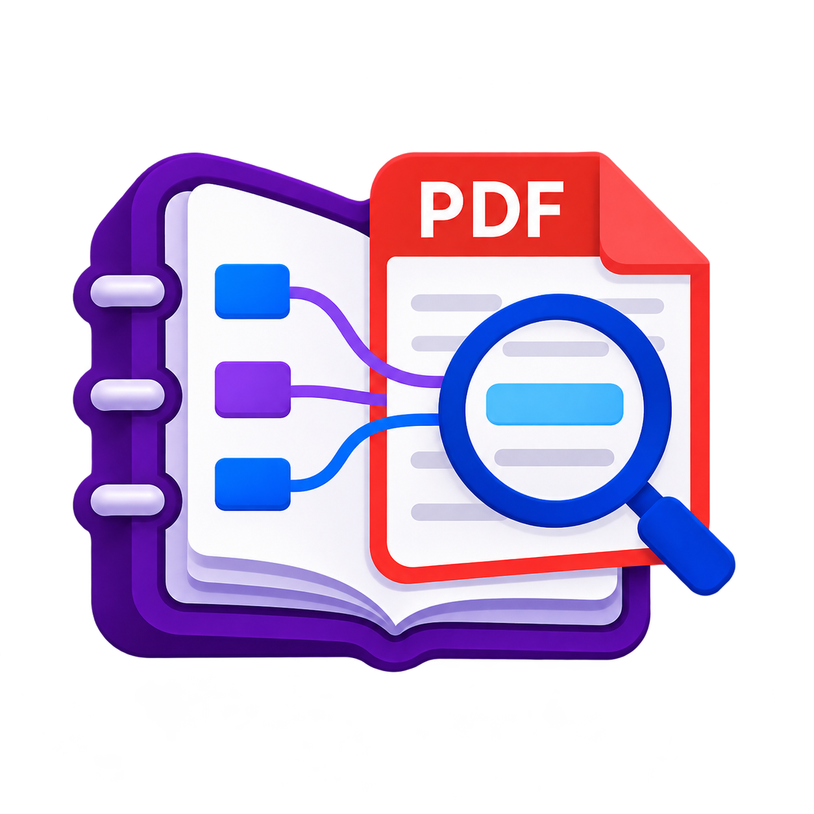
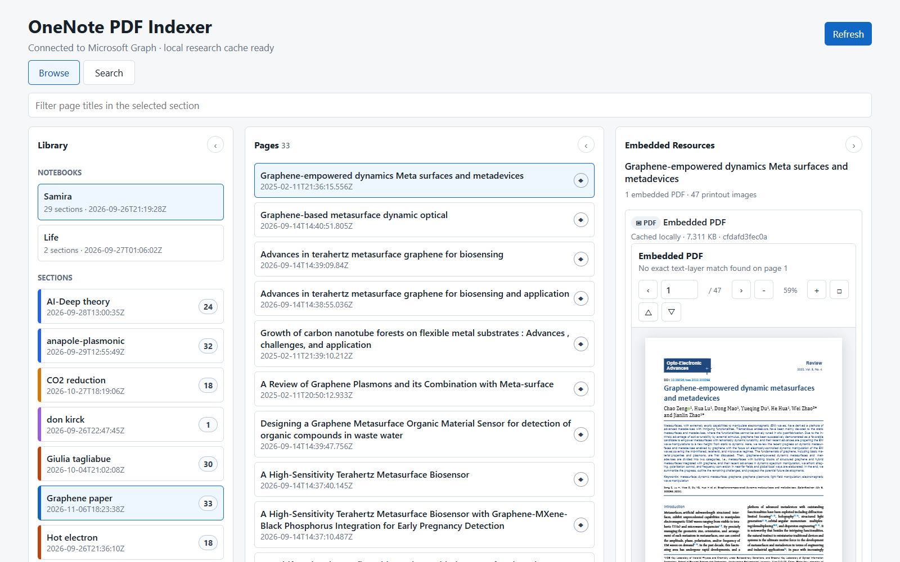
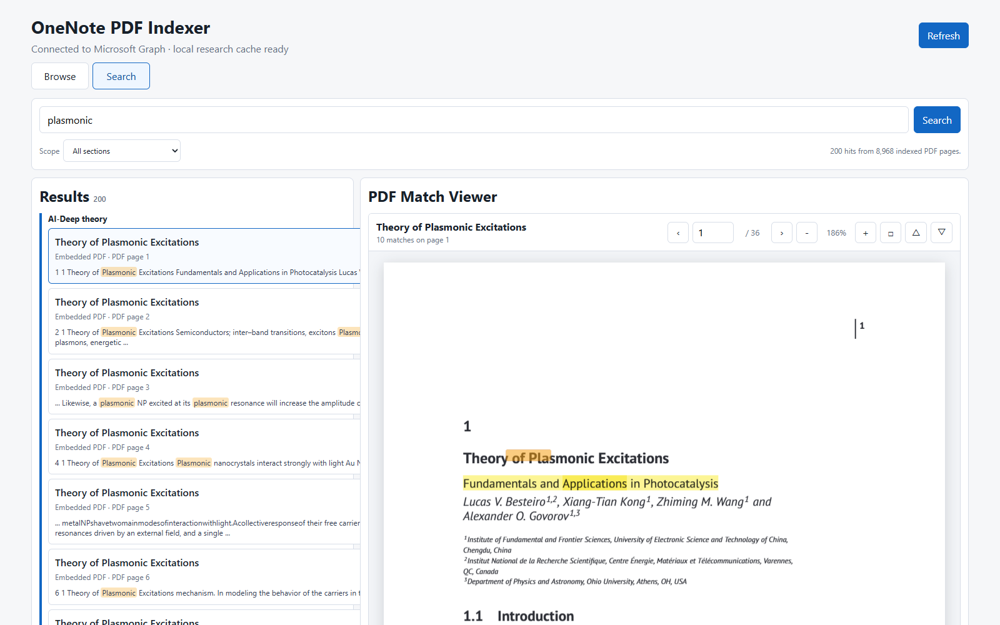

<p align="center">
  
</p>

# OneNote PDF Indexer

A private, local research browser for OneNote notebooks that contain embedded PDFs. It turns a large notebook into a searchable paper library while preserving the familiar notebook → section → page structure.

## What It Does

- **Browse the research library naturally.** Move from notebook to section to OneNote page, then read the associated paper without leaving the app.
- **Search across many PDFs at once.** Find a term across the cached library instead of opening and searching papers individually.
- **See where every result came from.** Results retain their OneNote section, OneNote page, PDF title, PDF page number, and a surrounding text snippet.
- **Open directly at the match.** The custom PDF viewer jumps to the relevant page and overlays translucent highlights while keeping the PDF text selectable.
- **Work from a resumable local cache.** Downloaded PDFs and extracted text remain available between sessions, and interrupted cache runs can continue without starting over.
- **Adapt the workspace.** Resize or collapse panels, sort sections and pages, filter by cache status, and switch between PDF, extracted text, and native OneNote-style page views.

## Screenshots

### Browse

Explore sections and pages beside the original embedded PDF:



### Search

Search the full cached library and inspect an exact highlighted PDF-page match:



## Project Status

The core browse-and-search workflow is functional:

- Microsoft Graph authentication and OneNote discovery
- section-by-section page loading for large notebooks
- resumable PDF download and local caching
- PDF text extraction and page-level full-text search
- grouped global results with snippets and PDF page numbers
- custom PDF.js rendering with selectable text and exact match highlights
- native OneNote page previews when no original PDF is available

Not yet implemented:

- OCR for image-only OneNote printouts
- natural-language AI answers with source citations
- hosted multi-user deployment and web-session authentication

## How It Works

```text
OneNote / OneDrive
       │
       ▼
Microsoft Graph ──► Python service ──► SQLite cache
                                         ├─ notebook/page metadata
                                         ├─ embedded PDF bytes
                                         └─ extracted text by PDF page
                                                    │
                                                    ▼
                                     Browse UI + global search + PDF.js viewer
```

The browser reads cached data first for a fast startup. Graph refreshes metadata and supplies resources that are not yet local. Original PDFs are stored as SQLite blobs; extracted text is indexed per PDF page so a result can reopen the exact source location.

## Requirements

- Windows
- Python 3.11 or newer
- Git
- A Microsoft Entra app registration configured as a public client
- Delegated Microsoft Graph permissions: `User.Read` and `Notes.Read`

The example configuration uses the `consumers` authority, which accepts personal Microsoft accounts only. To use a work or school account, the Entra registration and authority must support organizational accounts, and the organization must permit or approve the requested consent.

## Setup

```powershell
git clone https://github.com/nastajus/onenote_pdf_indexer.git
cd onenote_pdf_indexer

py -m venv .venv
.\.venv\Scripts\python.exe -m pip install --upgrade pip
.\.venv\Scripts\python.exe -m pip install -r requirements.txt
.\.venv\Scripts\python.exe -m pip install -e .

Copy-Item config\config.example.json config\config.json
```

Edit `config/config.json` and replace the placeholder app-registration values. These identifiers are configuration, not passwords; the reusable token cache is sensitive and remains ignored by Git.

## Connect to OneNote

Verify the signed-in identity and cloud notebook structure:

```powershell
.\.venv\Scripts\python.exe -m onenote_indexer whoami
.\.venv\Scripts\python.exe -m onenote_indexer notebooks
.\.venv\Scripts\python.exe -m onenote_indexer sections
.\.venv\Scripts\python.exe -m onenote_indexer pages --limit 25
```

If several Microsoft accounts are present, force the account chooser:

```powershell
.\.venv\Scripts\python.exe -m onenote_indexer whoami `
  --force-login `
  --login-hint "name@example.com"
```

If the browser redirect cannot complete, use device-code login:

```powershell
.\.venv\Scripts\python.exe -m onenote_indexer whoami --device-code --force-login
```

## Launch the Web App

Start the local server:

```powershell
.\.venv\Scripts\python.exe -m onenote_indexer.webapp --host 127.0.0.1 --port 8765
```

Then open [http://127.0.0.1:8765](http://127.0.0.1:8765).

For development, open the repository in VS Code and run **OneNote UI: Chrome**. The other included launch profiles start only the server or debug the notebook-listing CLI.

## Fill or Refresh the Cache

The default cache warmer is deliberately conservative:

```powershell
.\.venv\Scripts\python.exe -m onenote_indexer warm-cache `
  --max-pages 100 `
  --max-mb 750 `
  --delay 1.0
```

It downloads original PDFs, extracts searchable text, skips existing files, and can be safely resumed. Useful variants:

```powershell
# Limit work to matching sections
.\.venv\Scripts\python.exe -m onenote_indexer warm-cache --section "anapole" --max-pages 50

# Include OneNote printout images as well as PDFs
.\.venv\Scripts\python.exe -m onenote_indexer warm-cache --include-images --max-mb 250

# Re-fetch page and resource metadata
.\.venv\Scripts\python.exe -m onenote_indexer warm-cache --refresh-metadata
```

For large runs that trigger Microsoft Graph throttling, schedule slow resumable passes:

```powershell
powershell.exe -NoProfile -ExecutionPolicy Bypass -File .\scripts\resume_warm_cache.ps1
Get-Content .\data\warm-cache-resume.log -Wait
```

## Technical Notes and Limitations

- `application/pdf` resources are original embedded PDFs and can be text-indexed directly.
- `image-fullres` resources are normally OneNote printout images. They require OCR before their contents become searchable.
- Large libraries are enumerated section by section because broad Graph page requests can fail or throttle.
- Transient `429`, `500`, `502`, `503`, and `504` responses use retry and backoff. Cache warming remains resumable.
- Cached resources are preferred when a refreshed Graph URL becomes stale or returns `404`.
- Native OneNote HTML is sanitized and reflowed to reduce layout collisions caused by absolute-positioned text and images.
- The custom viewer currently loads PDF.js from a CDN, so first use requires internet access even when the requested PDF is cached locally.
- Graph can reveal cloud-side symptoms such as missing pages or stale resources, but authoritative desktop synchronization errors remain in OneNote’s **View Sync Status** dialog.

## Local Data and Privacy

The following files are intentionally excluded from Git:

- `config/config.json` — local app-registration configuration
- `data/token_cache.bin` — reusable Microsoft authentication tokens; do not share it
- `data/cache.sqlite3` — notebook metadata, embedded resources, PDF bytes, and extracted text
- `.venv/` — the local Python environment

The server binds to `127.0.0.1` by default. Do not expose it to a network or the public internet without adding proper web authentication, HTTPS, access control, and protected token storage.

## Development Checkpoints

After relevant changes, commit and push the current branch with:

```powershell
.\scripts\auto_commit.ps1 -Message "Codex checkpoint: short summary"
```

Use `-NoPush` only when a local-only checkpoint is intentional.
